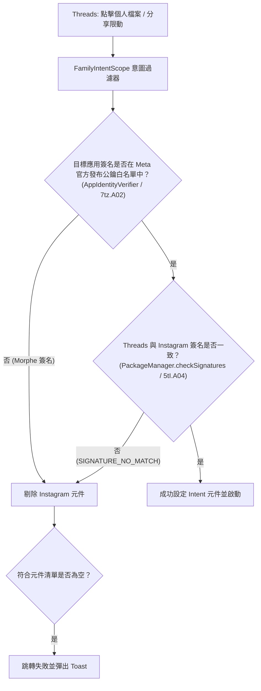

# Threads Link Fix (Morphe Patch)

[](https://morphe.software/add-source?github=snowindy0321/threads-link-fix)
[](https://github.com/snowindy0321/threads-link-fix/releases)
[](https://www.gnu.org/licenses/gpl-3.0)

專為 **Meta Threads (`com.instagram.barcelona`)** 設計的 Morphe 修補程式，徹底解決當裝置安裝修補版（如 **Morphe Instagram**、Instander 等非官方簽名版本）時，Threads 跨應用調用失敗的兩大痛點：

1. ❌ **無法開啟 IG 個人檔案**：從 Threads 個人頁點擊 Instagram 圖示，彈出 Toast 失敗錯誤。
2. ❌ **無法分享至 IG 限時動態**：從 Threads 貼文點擊分享至「Instagram 限時動態」無反應或失敗。

---

## 📲 一鍵新增至 Morphe Manager

在已安裝 **Morphe Manager** 的 Android 手機上，點擊下方按鈕即可一鍵新增此修補來源：

<div align="center">

<br/>

[](https://morphe.software/add-source?github=snowindy0321/threads-link-fix)

👉 **[按此直接在手機上新增來源 (Deep Link)](https://morphe.software/add-source?github=snowindy0321/threads-link-fix)**

<br/>

</div>

### 手動新增方式：
1. 開啟 **Morphe Manager**。
2. 進入下方導覽列的 **「來源」 (Sources)** 分頁。
3. 點擊右上角 **`+`**，貼上本儲存庫網址：
   ```text
   https://github.com/snowindy0321/threads-link-fix
   ```
4. 新增完成後，在修補應用程式時選擇 **Threads**，即可勾選套用 **`Fix Instagram integration`**。

---

## 🛠️ 問題根因與修補機制 (Root Cause & Mechanism)

Meta 在旗下家族應用間跳轉採用了專有的意圖安全框架 `FamilyIntentScope` (`LX/2Sh;`)：



### 修補原理
本修補程式透過 Morphe 位元組碼引擎在 Dalvik 層級注入：
* **`FamilyAppFilterFingerprint`**：錨定包含 `" is not an app matching the targeted app filter, but fail-open."` 的方法，執行 `returnEarly(true)`，直接繞過目標應用憑證白名單檢查。
* **`FamilySignatureVerifyFingerprint`**：錨定包含 `"Error verifying the signature for "` 的方法，執行 `returnEarly(true)`，直接繞過 `checkSignatures` 簽名匹配檢查。
* **底層補充校驗**：同時掛鉤底層身分校驗器，確保任何深層 Intent 與跨應用元件呼叫均將 Morphe Instagram 視為合格的 Meta 家族應用。

---

## 📦 版本發布與自動更新說明

本專案完全遵循 Morphe 官方標準發布規範：
* **自動化版本控制**：每一次版本修訂均透過 GitHub Releases 自動發布，附帶標準規範之 `patches-bundle.json`、`patches-list.json` 及 `.mpp` 修補套件。
* **無縫更新**：在 Morphe Manager 中新增來源後，只要本專案發布新 Release，Morphe Manager 即會自動檢查更新並提示使用者進行套件更新。

---

## 💻 專案架構

```
threads-link-fix/
├── .github/workflows/
│   └── release.yml                                   # GitHub Actions 自動打包發布
├── src/main/kotlin/app/morphe/patches/threads/
│   ├── InstagramIntegrationPatch.kt                  # Morphe BytecodePatch 核心定義
│   └── fingerprints/
│       ├── FamilyAppFilterFingerprint.kt             # 白名單校驗指紋
│       ├── FamilySignatureVerifyFingerprint.kt        # 簽名校驗指紋
│       ├── AppIdentityVerifierFingerprint.kt         # 身分驗證指紋
│       └── PackageSignatureVerifierFingerprint.kt    # 套件簽名指紋
├── build.gradle.kts
├── settings.gradle.kts
├── gradle.properties
├── patches-bundle.json                               # Morphe 來源索引清單
└── patches-list.json                                 # 修補項目清單
```

---

## 📄 授權條款

本專案基於 [GNU General Public License v3.0 (GPLv3)](LICENSE) 授權發布。
